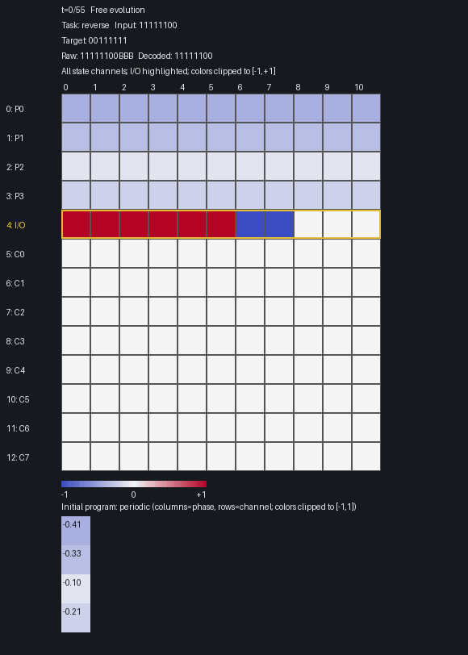

# NCPU-EM-1D

NCPU-EM-1D is a one-dimensional **neural cellular automaton (NCA)**, inspired by
[NCPU](https://ncpu.pages.dev/) and the paper
[*Emergent Models: Intelligence from Tiny Substrates*](https://arxiv.org/abs/2608.14019).
It is an active experimental part of the ongoing NCPU work.

It learns to transform binary strings: reverse them, copy them, negate
their bits, or perform other sequence operations. A small neural network acts
on neighboring cells of a one-dimensional tape. Repeated application of this
same local rule evolves the tape's continuous state to produce an output.



A reversal example from a trained model. Columns are tape positions; rows are
state channels. The shared input/output row is outlined in gold. Blue represents
`-1`, white `0`, and red `+1`. Values outside this range saturate the display
colors, not the underlying state.

## Tape, interface, and program

Data is represented with three symbols: binary `0`, binary `1`, and `B`.
`B` denotes a blank and can also separate values in a multi-output string.
Their direct encoding into the tape is:

| Symbol | State value |
|---|---:|
| `0` | -1 |
| `1` | +1 |
| `B` | 0 |

An **interface** is the convention for supplying inputs and reading outputs.
Here, input initializes one tape channel, and output is read from that same
channel after evolution. Numbers and other data can be encoded as strings
without changing this layout: the model operates on the encoding, not on
a particular data type. The supplied tasks operate on binary strings.

Each cell holds several continuous values, called **channels**: program values,
one mutable input/output value, and hidden computation values. State has shape
`[batch, channels, tape_slots]`. Every position is a tape cell; there are no
separate lanes or gaps between logical positions.

A **program** is learned, task-specific state placed in dedicated channels.
It is not source code or a hand-written list of instructions. Different tasks
have different program vectors but share the same update network; these vectors
condition the network's behavior.

Each task's program is a matrix `[program_length, program_channels]`. It can
repeat periodically across the tape or appear once as a prefix, followed by
zeros. Programs may be read-only during evolution or mutable. Read-only programs
still learn through gradients. A zero, read-only program is also available for
single-task training.

An **emergent model**, in this project, implements the overall transformation
through repeated local interactions. Training adjusts the local rule and program;
the intermediate computation is not hand-specified. “Emergent” describes how
the computation is organized, not a guarantee of generalization or universality.

## Local computation

Fixed and learned 1D kernels extract features from neighboring state values.
A pointwise MLP converts them into a residual update. The same parameters apply
at every position and every step.

Radius 1 uses the center and immediate neighbors; radius 2 extends to distance 2.
Perception includes identity, derivative, Laplacian, and neighbor features,
alongside trainable kernels. Tape boundaries use zero padding.

ReLU or Softplus, optional gates, firing probability, leak, clipping, and annealed
perception noise are configurable. There is no attention or state normalization.
For mutable channels:

```text
next_state = clip(state + fire_mask * (gated_delta - state_leak * state))
```

Clipping follows the masked update; frozen program channels are preserved exactly.
Fresh firing masks are sampled for each trajectory. Perception and the first
linear projection are algebraically fused into one convolution per step,
with gradients preserved.

## Training

Input and output start at the left edge and may differ in length. Both must fit
within `tape_slots - 1`, leaving at least one blank. Targets fill the remaining
tape with zeros, and MSE supervises every position, including those blanks.
Targets are never written into the evolving state.

Each optimizer update accumulates gradients from sequential trials with different
tape capacities, input maxima, and computation times. Each trial uses its own
shape, without padding to a common size. Tape capacity and input maximum are
varied independently; free evolution time scales with tape capacity and has its
own random variation.

With `F` free steps and `S` supervised steps, loss applies at steps `F+1` through
`F+S`. Invalid input maxima are resampled during training without changing the
sampled tape capacity.

The training domain contains all binary strings through each trial's input maximum,
indexed as empty, `0`, `1`, `00`, `01`, `10`, `11`, and so on. Batches sample
uniformly over **strings, not lengths**. Only requested batches are
generated; the complete dataset is not stored in RAM.

Tasks receive equal numbers of examples in a shuffled batch. Their loss weights
are configured as `TASKS = (("reverse", 2.0), ("copy", 1.0), ...)`. Each task's
MSE averages over examples, supervised steps, and tape positions:

```text
loss = sum(task_weight * task_mean_mse) / sum(task_weights)
```

Supported tasks: copy, bit_not, reverse, reverse_not, shift_left_zero,
shift_right_zero, gray_encode, prefix_xor, increment, parity, append_0, and append_1.
Shifts preserve width and insert a binary zero; increment wraps modulo
`2^input_length`. Empty input remains empty for length-preserving tasks,
produces `0` for parity, and produces the appended bit for append tasks.

Rule and program training flags and weight decays are independent. Learning rates
follow editable control points with linear or cosine interpolation.

## Run

Dependencies are Python 3.10–3.12, PyTorch, and Pillow. The notebook also uses
JupyterLab, IPykernel, and Matplotlib; tests use pytest. Versions are declared
in `pyproject.toml`. From the repository folder:

```
python -m pip install -e ".[notebook,dev]"
python -m jupyterlab notebooks/run.ipynb
```

The Python package is named `ncpu_computer_1d`. Run notebook cells in order:

1. **Configuration:** edit tasks, model, training settings, and test cases.
   Structural checks always run here.
2. **Training/loading:** train, resume, or load a checkpoint. Plots show per-task
   validation accuracy, running mean loss, and learning rate.
3. **Evaluation:** run the explicit test cases.
4. **Visualization:** choose an input and save all-channel evolution to
   `outputs/output.gif`.
5. **Programs:** inspect the learned task programs.

The supplied setup uses reverse, copy, and both zero-filling shifts,
with **2,000 optimizer updates** and **1,000 examples per final test and task**.
General hyperparameters are in the first cell; workflow controls are in their
respective cells. Restart the kernel after changing the implementation.

## Evaluation and checkpoints

Periodic validation evaluates all strings through the base input maxima at fixed
base geometries and times. Weighted validation MSE selects `best.pt`.

Final tests use strings of **exactly the specified length**, including leading
zeros. Their tape capacities and times are explicit; invalid cases raise errors
rather than being truncated or resampled. Training and test times are independent:
the supplied training uses four free steps per slot, while the fixed final cases
use three.

`EVALUATION_MAX_EXAMPLES = 1000` selects a reproducible uniform subset without
replacement, shared across tasks. `None` evaluates every string: a 21-bit case
contains over two million examples per task. Evaluation streams batches, but
exhaustive computation can still be slow. This limit does not affect training
or periodic validation.

Readout maps values above `+0.333` to `1`, below `-0.333` to `0`, and the middle
interval to `B`. Single-output interpretation stops at the first blank;
multiple-output interpretation stops at two consecutive blanks.

- **Semantic:** correct output and terminator, ignoring later tail cells.
- **Raw:** the entire tape matches, including blanks.
- **Symbol:** fraction of matching tape cells.
- **Stable:** semantic correctness throughout the evaluation window.

Final MSE and semantic/raw/symbol scores average over that window. Task aggregates
are unweighted. Evaluation uses the in-memory model unless checkpoint loading
is selected.

Checkpoints are saved locally under `checkpoints/<experiment>/`.
`best.pt` selects validation performance; `latest.pt` supports exact resume,
including optimizer and RNG states. Resume requires matching configuration and
task weights. Changing the update count changes the learning-rate timeline.
Preserve checkpoints before reusing an experiment name; they are not included
in the repository.

## Scope and checks

Reversal extrapolation remains experimental. One 6,000-update multitask run
achieved 77.79% semantic accuracy at input length 19 and 39.06% at length 21
on 1,000 sampled inputs; copy and shifts were near 100%. These are single-run
observations, not guaranteed results for the supplied 2,000-update setup.

The project is self-contained: `src/` holds the implementation, `notebooks/`
the workflow, `tests/` the regression tests, and `assets/` the README animation.
Generated outputs and checkpoints are ignored by Git.

```
python -m pytest -q
```

Tests cover task semantics, model outputs and gradients, weighted loss, sampling,
different-length accumulation, streaming evaluation, checkpoint resume, and
tiny notebook/GIF runs. They do not run expensive training.
